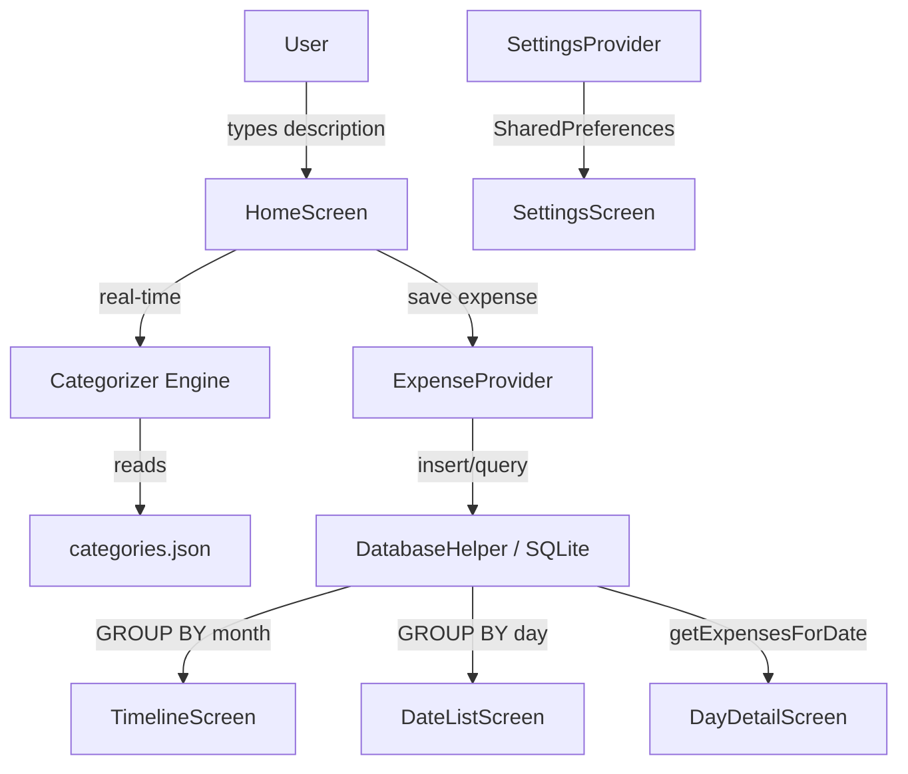

# Expense Tracker

> Zero-friction. Fully offline.
> Log an expense in under 3 seconds.

---

## Quick Start

### Prerequisites
| Tool | Min Version |
|------|-------------|
| Flutter SDK | 3.19+ |
| Dart | 3.0+ |
| Android Studio / Xcode | Latest stable |

### Run the app
```bash
flutter pub get
flutter run
```

---

## Project Structure

```
lib/
├── main.dart                      # Entry point + app shell (IndexedStack)
│
├── core/
│   ├── categorizer.dart           # ★ Offline keyword-matching engine
│   ├── theme.dart                 # Dark theme, Outfit font, design tokens
│   └── currency.dart              # Supported currencies list
│
├── data/
│   ├── models/
│   │   ├── expense.dart           # Expense data model (fromMap / toMap)
│   │   └── category_meta.dart     # Category with emoji, color, keywords
│   └── database/
│       └── database_helper.dart   # SQLite CRUD + GROUP BY queries
│
├── providers/
│   ├── expense_provider.dart      # Expense state (today, monthly, daily)
│   └── settings_provider.dart    # Currency pref (SharedPreferences)
│
├── screens/
│   ├── home_screen.dart           # Quick-entry + live category badge
│   ├── timeline_screen.dart       # Month-by-month totals
│   ├── date_list_screen.dart      # Dates within a month
│   ├── day_detail_screen.dart     # Ledger + swipe-to-delete
│   └── settings_screen.dart      # Currency + Keyword Manager
│
└── widgets/
    ├── category_badge.dart        # Animated category pill
    └── bottom_nav.dart            # 3-tab bottom navigation

assets/
└── data/
    └── categories.json            # Keyword dictionary (edit to customise)
```

---

## Architecture



---

## Database Schema

```sql
CREATE TABLE expenses (
  id          INTEGER PRIMARY KEY AUTOINCREMENT,
  amount      REAL    NOT NULL,
  description TEXT    NOT NULL,
  category    TEXT    NOT NULL,
  timestamp   INTEGER NOT NULL        -- Unix epoch ms (local time)
);

CREATE INDEX idx_timestamp ON expenses (timestamp DESC);
```

### Key Queries

**Monthly totals (Timeline)**
```sql
SELECT
  strftime('%Y', datetime(timestamp/1000, 'unixepoch', 'localtime')) AS year,
  strftime('%m', datetime(timestamp/1000, 'unixepoch', 'localtime')) AS month,
  SUM(amount) AS total
FROM expenses
GROUP BY year, month
ORDER BY year DESC, month DESC
```

**Daily totals (Date Drill-Down)**
```sql
SELECT
  strftime('%d', datetime(timestamp/1000, 'unixepoch', 'localtime')) AS day,
  SUM(amount) AS total
FROM expenses
WHERE timestamp >= ? AND timestamp < ?     -- month boundaries
GROUP BY day
ORDER BY day DESC
```

---

## Offline Auto-Categorization Engine

Located in [`lib/core/categorizer.dart`](lib/core/categorizer.dart).

**Algorithm (3 steps, zero network):**

```
Input: "Swiggy biryani"

1. NORMALISE  → "swiggy biryani"  (lowercase + strip punctuation)
2. MATCH      → scan categories.json keywords for substring match
                "swiggy" ∈ Food.keywords  → ✓ match
3. RETURN     → CategoryMeta { id: "food", emoji: "🍔", color: #FF6B35 }

Fallback: if no match → "misc" 🏷️
```

**Categories built-in:**

| Category | Emoji | Sample Keywords |
|----------|-------|-----------------|
| Food | 🍔 | zomato, swiggy, lunch, coffee, grocery, blinkit |
| Travel | 🚕 | uber, ola, metro, flight, irctc, rapido |
| Bike | 🛵 | petrol, mechanic, parking, tyre, service |
| Entertainment | 🍿 | movie, netflix, party, pvr, spotify |
| Health | 💊 | medicine, doctor, gym, pharmacy, apollo |
| Shopping | 🛍️ | amazon, flipkart, myntra, clothes, shoes |
| Bills | 📱 | electricity, rent, wifi, recharge, emi |
| Other | 🏷️ | *(fallback)* |

**Add custom keywords** → Settings → Keyword Manager → tap any category.

---

## Dependencies

| Package | Purpose |
|---------|---------|
| `sqflite` | Local SQLite database |
| `path` | DB path construction |
| `provider` | Lightweight state management |
| `google_fonts` | Outfit typeface |
| `flutter_slidable` | Swipe-to-delete gesture |
| `intl` | Date/number formatting |
| `shared_preferences` | Persist currency setting |

---

## Design System

| Token | Value |
|-------|-------|
| Background | `#0A0A0A` |
| Surface | `#141414` |
| Surface Variant | `#1E1E1E` |
| Border | `#2A2A2A` |
| Text Primary | `#F5F5F5` |
| Text Muted | `#6B7280` |
| Font | Outfit (Google Fonts) |
| Display Size | 64px / weight 300 |

---

## Extending the App

### Add a new category
Edit [`assets/data/categories.json`](assets/data/categories.json):
```json
{
  "id": "education",
  "label": "Study",
  "emoji": "📚",
  "color": "#F59E0B",
  "keywords": ["udemy", "coursera", "book", "course", "tuition"]
}
```

### Add your own keywords at runtime
Open **Settings → Keyword Manager**, tap any category, type a keyword, press **+**.

---

## License
MIT
